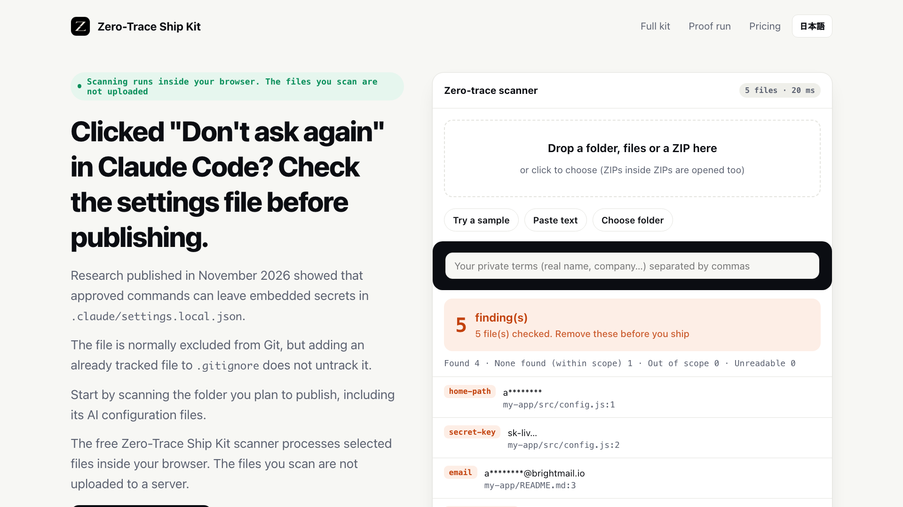

[](https://zero-trace-ship-kit.zeus-lab-global.workers.dev/hq/?utm_source=github_repo)

# Zero-Trace Lite

[](https://zero-trace-ship-kit.zeus-lab-global.workers.dev/badge/?utm_source=readme_badge)

Add the same badge to your own README once the check runs on your repository: copy the line above, or see https://zero-trace-ship-kit.zeus-lab-global.workers.dev/badge/?utm_source=github_repo .

A small local check before your work leaves your machine.

A free CLI and local MCP server for supported leak patterns in plain-text files—including secrets left in Claude Code settings.

Python 3.9+ · Standard library only · Local stdio MCP · MIT-licensed Python files

**[Try the browser scanner](https://zero-trace-ship-kit.zeus-lab-global.workers.dev/?utm_source=github_repo)** | **[Get the free download ($0+)](https://zeuslab.gumroad.com/l/zero-trace-lite)** | **[See the full kit ($39 / Team $149)](https://zeuslab.gumroad.com/l/zero-trace-ship-kit)**

[](https://zero-trace-ship-kit.zeus-lab-global.workers.dev/?utm_source=github_repo#demo)

*Still image. The 15-second demo plays on the [demo page](https://zero-trace-ship-kit.zeus-lab-global.workers.dev/?utm_source=github_repo#demo).*

## Quick start

```sh
git clone https://github.com/ZEUSLABZERO/zero-trace-lite.git
cd zero-trace-lite
python3 zero_trace_lite.py path/to/folder
```

It exits with code 1 when anything is found. Values are masked in the report. The tool opens no network connection.

Clicked "Don't ask again" in Claude Code? Approved commands are saved as literal strings in `.claude/settings.local.json`, including any password or token typed inline. The file is normally excluded from Git, but adding an already tracked file to `.gitignore` does not untrack it.

## What it reports (plain-text files)

- Secrets inside the permission rules of `.claude/settings.local.json` and `.claude/settings.json`, and the `.claude/.credentials.json` file
- Inline passwords: the `PGPASSWORD` / `MYSQL_PWD` / `REDISCLI_AUTH` variables, the password option of command-line clients, database URIs that carry a password
- Common secret-key formats and private keys
- Home paths with a login name (macOS, Linux, Windows)
- E-mail addresses

Obvious placeholders such as `<password>` or `$DB_PASS` are not reported.

## Local MCP server

`mcp_server_lite.py` lets Claude Desktop, Claude Code or Cursor ask for the same report over stdio.

```json
{"mcpServers": {"zero-trace-lite": {"command": "python3", "args": ["/absolute/path/to/mcp_server_lite.py"]}}}
```

Tools: `scan_path` (a folder or a text file) and `scan_text` (a snippet). Read-only. The server imports nothing outside the Python standard library. That removes third-party package drift; it does not remove supply-chain risk as a whole. Read the two files before you run them — they are short.

## GitHub Action

```yaml
- uses: actions/checkout@v4
- uses: ZEUSLABZERO/zero-trace-lite@main
  with:
    path: "."                  # optional
    fail-on-findings: "true"   # optional; "false" reports without failing the job
```

The result is written to the job summary. The runner needs `python3` (GitHub-hosted runners have it).

## Lite / Solo / Team

| | Lite (this repository) | Solo $39 | Team $149 |
|---|---|---|---|
| Report on plain-text files, CLI | ● | ● | ● |
| Local MCP server | ● (report only) | ● | ● |
| Git hooks that stop the commit or push on supported findings | — | ● | ● |
| Checks inside ZIPs (nested), photo GPS, PDF and Office author fields | — | ● | ● |
| Cleaned distribution ZIPs, cost guard | — | ● | ● |
| People covered | anyone (MIT) | 1 | up to 10 in one organization |
| License | MIT (the two Python files here) | commercial, one-time | commercial, one-time |

For a setup that also relays reviews between AIs and shows the activity on a local board: [Autonomous Harness ($149)](https://zero-trace-ship-kit.zeus-lab-global.workers.dev/harness/?utm_source=github_repo).

## Scope and license

- It reads plain text only. ZIP, Office, PDF and image files are not opened.
- It reports. It does not stop a commit or push.
- "No findings" means no supported pattern was detected; it does not prove that the files contain no secrets.
- A credential that reached Git history or a remote must be revoked at its issuer. Deleting the file does not take it back.

```sh
git ls-files .claude                                   # is it tracked?
git log --oneline --all -- .claude/settings.local.json # was it ever committed?
git rm --cached .claude/settings.local.json            # stop tracking (the file stays on disk)
```

**License:** `zero_trace_lite.py`, `mcp_server_lite.py` and `action.yml` are released under the MIT License (see `LICENSE`). The paid Zero-Trace Ship Kit is a separate product under its own commercial license and is not part of this repository. © 2026 ZEUS LAB

If this saved you a worry before a push, a star helps other people find it.

---

**日本語の要約：** 公開しようとしているフォルダの文章ファイルから、Claude Code の設定ファイルに残った秘密情報、インラインのパスワード、秘密キー、ユーザー名入りのパス、メールアドレスを一覧にする無料の道具です。手元で動き、外部へ接続しません。報告のみで、commit / push は止めません。検出0件は「対応パターンが見つからなかった」という結果であり、秘密情報が存在しないことの証明ではありません。この2つのPythonファイルと `action.yml` は MIT ライセンスです。commit / push を止めるGitフックなどを含む有料の Zero-Trace Ship Kit は、別の商用ライセンスの別商品です。
